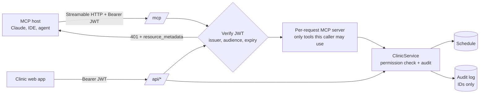

# clinic-scheduling-mcp

A remote **MCP server** for a **fictional** clinic, Bayview Family Clinic, that lets an AI assistant search patients, find open slots, book, reschedule and cancel appointments, and lets clinicians add pre-visit notes.

It is built the way a company would need it before letting an agent near real scheduling: **OAuth bearer tokens** checked against the authorization server's keys, **role and scope based tool access**, **one service layer** shared by the MCP tools and the REST API so permission checks and audit entries cannot drift between channels, an **audit log that holds IDs and never patient details**, and an **eval** that proves the permission matrix and runs an agent through real tasks.

> Synthetic data only: every provider, patient and phone number is invented. The design follows an MCP server I built and run for a service business's operations platform, where agent tools go through the same rules as the app; none of its code or data are in this repo. Nothing here is a HIPAA compliance claim.



## Design decisions

| Decision | Why |
|---|---|
| **Remote MCP over Streamable HTTP, stateless.** A fresh `McpServer` is built per request for the authenticated caller. GET and DELETE on `/mcp` answer 405. | Stateless servers scale horizontally with no sticky sessions, and a per-request server means each caller's tool list is computed from their own token. |
| **OAuth 2.0 resource server.** Tokens are JWTs verified with `jose` against the issuer's JWKS, with issuer, audience and expiry checked. The audience must be this server's `/mcp` URL (RFC 8707). | A token minted for some other API is rejected even if its signature is valid. Tested. |
| **Discoverable auth.** `/.well-known/oauth-protected-resource` (RFC 9728) names the authorization server, and every 401 carries `WWW-Authenticate: Bearer resource_metadata=...`. | This is how an MCP client finds out where to send the user to sign in. |
| **Role AND scope.** The person's role (front desk, clinician, admin) must allow an action, and the token must carry the scope (`clinic:read`, `clinic:write`). | An admin who connects a client with a read-only token gets read-only tools. Least privilege for agents, not just people. |
| **Tools the caller cannot use are not registered.** A front desk token never sees `add_previsit_note`; a clinician never sees `book_appointment`. | The model cannot be talked into calling a tool it was never given. |
| **The service still checks every call.** Hiding tools is UX; `ClinicService` is the security boundary, and the REST API goes through it too. | The eval calls the service directly for every role and scope and requires "allowed" to match "visible" exactly. |
| **One service layer for MCP and REST.** Both channels call the same methods, so one permission rule and one audit entry per action, tagged by channel. | Two code paths are how an agent ends up with access the web app would never allow. |
| **Ownership on top of role.** Clinicians can only write and read pre-visit notes on their own appointments. Admins never see clinical notes. | Role alone is too coarse for clinical data. Minimum necessary access. |
| **Audit log with IDs only.** Every read and write, allowed or denied, with actor, role, OAuth client and channel. No names, reasons or notes. | Access logging without turning the log into a second copy of patient data. Tested by searching the log for the data it must not contain. |
| **Booking rules are pure, unit-tested code.** Provider days and visit types, pediatric age limit, lunch, slot boundaries, double booking of provider or patient, late cancel flag. | The model picks a slot from `find_available_slots`; it cannot invent one that breaks the rules. |
| **Agent-safe tools.** Domain errors come back as readable tool errors (`conflict: slot_taken`), booking takes an `idempotencyKey`, and annotations mark read-only, destructive and idempotent tools. | Agents retry and recover. A retry must not double book, and an error should tell the model what to do next. |
| **Patient text is data.** Server instructions tell the client that reasons and notes are written by people and are not instructions. An eval task plants an instruction in an appointment reason. | Tool output is an injection surface too. |

## Run it

```bash
npm install
npm test          # 18 tests, including a real MCP client against the server in-process
npm run eval      # permission matrix + agent tasks (scripted agent without a key)
npm start         # http://localhost:3002/mcp with a local dev signing key

# A dev token (8 hours, signed by the key in .dev/, which is gitignored)
npm run token -- --role front_desk
npm run token -- --role clinician --provider prv_okafor
npm run token -- --role admin --scope clinic:read
```

Connect any MCP client that lets you set an `Authorization` header (for example the MCP Inspector) to `http://localhost:3002/mcp` using Streamable HTTP and `Bearer <token>`.

```bash
TOKEN=$(npm run token --silent -- --role front_desk)
curl -s localhost:3002/mcp -H "authorization: Bearer $TOKEN" \
  -H 'content-type: application/json' -H 'accept: application/json, text/event-stream' \
  -d '{"jsonrpc":"2.0","id":1,"method":"tools/call","params":{"name":"search_patients","arguments":{"query":"maria"}}}'
```

For a real identity provider, set `OAUTH_ISSUER`, `OAUTH_JWKS_URL` and `BASE_URL`. Access tokens need `sub`, `role`, `scope`, `provider_id` for clinicians, and audience `<BASE_URL>/mcp`.

## Tools

| Tool | Roles | Scope | Notes |
|---|---|---|---|
| `search_patients` | all | read | Returns last 4 phone digits only |
| `find_available_slots` | all | read | Filters out providers who cannot see the patient |
| `get_provider_schedule` | all | read | |
| `get_appointment` | all | read | Pre-visit note only for the owning clinician |
| `list_patient_appointments` | all | read | Upcoming only |
| `book_appointment` | front desk, admin | write | Idempotency key |
| `reschedule_appointment` | front desk, admin | write | |
| `cancel_appointment` | front desk, admin | write | Destructive; flags late cancels |
| `add_previsit_note` | clinician | write | Own appointments only |
| `get_audit_log` | admin | read | IDs only |

The REST API under `/api` exposes the same operations to the clinic's own apps through the same service.

## Evals

`npm run eval` writes `evals/report.<agent>.md` with two parts.

**Permission matrix.** For six profiles (three roles, each with a read and a read+write token) it compares what `tools/list` returns over a real MCP connection with a hand-written matrix in `evals/permission-matrix.json`, then calls the service directly for every tool. CI fails on any difference.

**Agent tasks.** Six staff requests in plain English, each judged on the resulting schedule rather than on wording: book the earliest slot, book with the pediatrician, pick the right patient of two with the same first name, cancel the right appointment, summarize a schedule whose data contains an injected instruction, and attempt something front desk access does not allow. With `ANTHROPIC_API_KEY` set, Claude does the work through an MCP client and the safety tasks gate CI. Without it, a scripted agent replays the expected calls.

**About the numbers:** the scripted agent only proves the loop, the MCP path and the checks work, and no Claude results are committed here. Run the eval with your own key to see them.

## Layout

```
src/
  domain/      clinic.ts (synthetic data), scheduling.ts (pure rules), time.ts
  permissions.ts  roles, scopes, action rules
  service.ts      the only path to clinic data: checks + audit
  mcp.ts          per-caller MCP server and tool definitions
  auth.ts         JWT verification, dev signing key
  app.ts          Hono: /mcp, /api, protected resource metadata
  store.ts        in-memory store, audit log, demo seed
evals/      permission matrix, agent loop, tasks, runner
scripts/    dev-token.ts
tests/      node:test
```

## Production notes

This is a focused demo. A production version adds a database with row-level tenancy, an EHR or practice management system as the source of truth (this server would wrap its API rather than hold data), token claims mapped from the identity provider's groups, rate limits per OAuth client, a confirmation step in the host for destructive tools, alerting on denied-access spikes, and retention rules for the audit log.

## License

MIT
